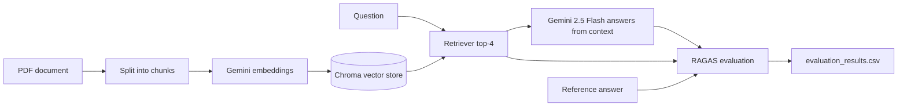

# RAG Evaluation with RAGAS

Building a RAG (Retrieval-Augmented Generation) pipeline is easy. Knowing whether it actually works is the hard part. This project builds a RAG pipeline over a PDF document and then **measures its quality with [RAGAS](https://docs.ragas.io/)**, a framework that scores both the retrieval and the generation side of a RAG system.

## What it does

1. Loads a PDF on sustainable development and splits it into chunks
2. Embeds the chunks and stores them in a Chroma vector database
3. Answers questions using only the retrieved context
4. Runs 10 question and reference-answer pairs through the pipeline
5. Scores the results with RAGAS and saves them to `evaluation_results.csv`



## The RAG pipeline

Defined in `rag_pipeline.py`:

| Component | Choice |
|-----------|--------|
| Document loader | `PyPDFLoader` on `document/sustainable_development.pdf` |
| Chunking | `RecursiveCharacterTextSplitter`, chunk size 800, overlap 150 |
| Embeddings | Google `gemini-embedding-001` |
| Vector store | Chroma, persisted in `data/chroma_db` |
| Retriever | Top 4 most similar chunks (`k = 4`) |
| LLM | `gemini-2.5-flash` with temperature 0 |
| Prompt | Answer using only the given context, and say "I don't know" if the answer isn't there |

## The evaluation

Defined in `evaluate_rag.py`. For each of the 10 questions, the script retrieves context, generates an answer, and builds a RAGAS dataset with four fields:

| Field | Meaning |
|-------|---------|
| `user_input` | The question |
| `retrieved_contexts` | The chunks the retriever returned |
| `response` | The pipeline's answer |
| `reference` | The ground-truth answer |

RAGAS then scores the dataset, and the results are saved to `evaluation_results.csv`.

### Sample questions

| Question | Reference answer |
|----------|------------------|
| What are the three pillars of sustainable development? | Economic growth, social inclusion, and environmental protection |
| How many global goals did countries agree on in the 2030 Agenda? | 17 Sustainable Development Goals |
| What is the Paris Agreement's temperature target? | Limit global warming to 1.5°C above pre-industrial levels |
| What does a circular economy try to reduce? | Waste, by keeping products and materials in use longer |

## Understanding the metrics

RAGAS scores RAG systems on these standard metrics. Each is a score from 0 to 1, and higher is better. ⚠️ Check which ones your RAGAS version runs by default, and which columns appear in your CSV.

| Metric | Question it answers | Low score usually means |
|--------|---------------------|-------------------------|
| **Faithfulness** | Is the answer supported by the retrieved context? | The model is hallucinating |
| **Answer relevancy** | Does the answer actually address the question? | Off-topic or vague answers |
| **Context precision** | Are the relevant chunks ranked near the top of the retrieved results? | Noisy retrieval |
| **Context recall** | Did retrieval find all the information needed for the reference answer? | Chunks are too small, `k` is too low, or content is missing |

**Retrieval problem or generation problem?** Low context precision or recall points at retrieval (chunking, embeddings, `k`). Low faithfulness with good retrieval points at generation (the prompt or the model).

## Project structure

```
RAG-Evaluation/
├── document/                 # Source PDF
├── metrics_evaluation/       # Metric notes / experiments 
├── main.py                   # Builds the pipeline and runs the evaluation
├── rag_pipeline.py           # Loader, splitter, embeddings, vector store, chain
├── evaluate_rag.py           # Question set and RAGAS evaluation
├── requirements.txt
└── README.md
```

Generated when you run it: `data/chroma_db/` and `evaluation_results.csv`.

## Getting started

### Prerequisites

- Python 3.10 or higher
- A Google Gemini API key ([Google AI Studio](https://aistudio.google.com/))

### Installation

```bash
git clone https://github.com/SyedaNaziaGit/RAG-Evaluation.git
cd RAG-Evaluation
python -m venv venv
source venv/bin/activate        # Windows: venv\Scripts\activate
pip install -r requirements.txt
```

### Configuration

Create a `.env` file in the project root:

```env
GEMINI_API_KEY=your_gemini_api_key
GOOGLE_API_KEY=your_gemini_api_key
```

> `evaluate_rag.py` reads `GEMINI_API_KEY`, and LangChain's Google integration typically reads `GOOGLE_API_KEY`, so set both to the same key. ⚠️ RAGAS may also need `OPENAI_API_KEY` if no evaluator LLM is set explicitly.
> Never commit your `.env` file.

### Run

```bash
python main.py
```

This builds the pipeline, runs all 10 questions, and writes `evaluation_results.csv`.

## Results

| Metric | 
|--------|-------|
| Faithfulness | 
| Answer relevancy | 
| Context precision | 
| Context recall |

## What I learned

- Why RAG systems need measurable evaluation, not just "it looks right"
- Separating retrieval quality from generation quality
- Building an evaluation dataset of questions, retrieved contexts, answers, and references
- Using RAGAS to score faithfulness, relevancy, precision, and recall
- Tuning chunk size, overlap, and `k` against the scores


## Author

**Syeda Nazia** · [GitHub](https://github.com/SyedaNaziaGit) · [LinkedIn](https://www.linkedin.com/in/syeda-nazia) · [Portfolio](https://syedanaziagit.github.io/nazia_portfolio_website/)
